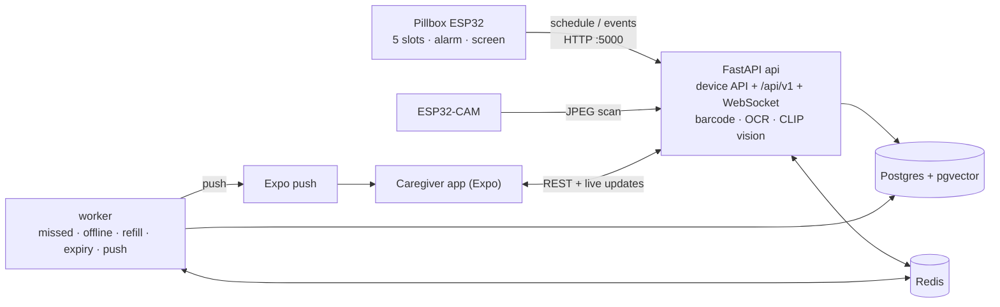

# VOICE: medicine reminder prototype

This repo is the backend and caregiver app for an ESP32 pillbox:
- **The pillbox** reminds the patient at dose time.
- **Its camera** recognises medicine packages.
- **Family caregivers** follow everything live on their phone.

Everything runs in Docker. The pillbox firmware is fixed, and the backend speaks its exact API.



More detail: [docs/architecture.md](docs/architecture.md) · API: [docs/api.md](docs/api.md) · Decisions: [docs/decisions.md](docs/decisions.md) · Conventions: `.claude/skills/`.

## Repository
| Path | What |
|---|---|
| `services/api` | FastAPI app + worker (Python 3.12, SQLAlchemy 2, Alembic, uv), vision pipeline, tests |
| `apps/mobile` | Expo SDK 58 + TypeScript + Expo Router caregiver app |
| `tools/device-sim` | Simulator that acts like both ESP32s (stdlib Python) |
| `docs/` | architecture, API, setup, decisions |
| `docker-compose*.yml`, `Makefile`, `Caddyfile` | dev / prod stacks |

## Set up on a new laptop (one time, Windows)

Everything runs in Docker, so a new laptop needs only these tools. You don't need Python or Node.

1. **Install the tools**
   - [Docker Desktop](https://www.docker.com/products/docker-desktop/) (keep the default WSL 2 option). Start it and wait until it says *Engine running*.
   - [Git for Windows](https://git-scm.com/download/win). It includes **Git Bash**; use Git Bash for the commands below.
   - Optional, for the short `make` commands: open PowerShell and run `winget install ezwinports.make`, then reopen Git Bash. Without make, use the `docker compose` commands in the table under "Run it" below.
   - On the phone: **Expo Go** from the Play Store or App Store.
2. **Get the code** (`git clone <repo-url> medicine-reminder`, or copy the project folder).
3. **Open the firewall:** double-click **`setup-voice.cmd`** and click *Yes* when Windows asks for admin. It opens ports 5000 (API) and 8081 (app) on every network type, including phone hotspots.
4. **Turn on the Windows Mobile hotspot** for the VOICE device (Settings → Network & internet → Mobile hotspot):
   - *Share my internet connection from:* **Wi-Fi** (the laptop stays on the phone hotspot for internet).
   - *Network name / password:* the Wi-Fi name and password flashed into VOICE.
   - The laptop's address on its own hotspot is **always `192.168.137.1`** on every Windows laptop, so VOICE is flashed once with `BACKEND_URL "http://192.168.137.1:5000"` and works with any laptop that runs this repo.
   - If the Wi-Fi card can't share Wi-Fi over Wi-Fi, connect the phone by USB and turn on **USB tethering** instead, then share that connection.

You don't edit `.env`: the first start creates it with random secrets.

### How the pieces connect

```
 phone (hotspot, internet) ──Wi-Fi──► laptop ◄──Wi-Fi── VOICE device
   runs the VOICE app        detected IP  │  192.168.137.1 (fixed)
                                          └─ Docker: API :5000, app server :8081
```

## Run it

Double-click **`start-voice.cmd`** (or run `.\start-voice.cmd` in PowerShell). It:
1. creates `.env` on the first run,
2. finds the laptop's IP on the phone hotspot and saves it as `LAN_IP` (the phone hotspot gives a different IP each time, so this runs on every start),
3. starts Docker (first run builds everything: 10–20 min, ~3 GB download), and
4. prints the addresses:

```
Phone app (Expo Go):  exp://172.20.10.3:8081
API for the app:      http://172.20.10.3:5000   (docs: /docs)
VOICE device URL:     http://192.168.137.1:5000   (hotspot is on)
```

Then:
1. On the phone, open Expo Go and type the `exp://…` address (or scan the QR code from `docker compose logs -f mobile`).
2. Sign in with **demo@example.com / demo1234**.
3. No device yet? Try `make sim` (see Demo below).

If the phone with the app is connected to the **laptop's** hotspot instead of providing one, start with `.\start-voice.cmd -Hotspot`, so the app uses `192.168.137.1` too.

Other commands:

| Do this | With make | Without make |
|---|---|---|
| Start (no IP detection) | `make up` | `docker compose -f docker-compose.yml -f docker-compose.dev.yml up -d --build` |
| Status | `make ps` | `docker compose -f docker-compose.yml -f docker-compose.dev.yml ps` |
| Logs / QR code | `make logs` / `make logs-mobile` | `docker compose -f docker-compose.yml -f docker-compose.dev.yml logs -f mobile` |
| Device simulator | `make sim` | `docker compose -f docker-compose.yml -f docker-compose.dev.yml run --rm --no-deps -w /sim api-test python sim.py --base http://api:5000 day` |
| Tests | `make test` | see the `test-api` / `test-mobile` lines in the `Makefile` |
| Fresh demo data | `make reset-seed` | `docker compose -f docker-compose.yml -f docker-compose.dev.yml exec api python -m app.seed --reset` |
| Stop (data is kept) | `make down` | `docker compose -f docker-compose.yml -f docker-compose.dev.yml down` |

**If something doesn't work:**
- **Phone can't connect:** run `setup-voice.cmd` once, then `start-voice.cmd` again. The address in Expo Go must match what `start-voice.cmd` printed; it changes when the phone hotspot restarts.
- **VOICE device shows Offline:** check that the Windows Mobile hotspot is on and that VOICE joined it (Settings → Mobile hotspot lists connected devices).
- **"Port is already allocated" for 5000:** another program is using it. Stop it. For testing without the device, you can set `API_PORT=5055` in `.env` instead.

More detail, including real push notifications and production: **[docs/setup.md](docs/setup.md)**.

To keep the data in the cloud (shared by every laptop), use Supabase as the database: **[docs/supabase.md](docs/supabase.md)**.

The seed creates caregiver `demo@example.com`, patient **Lola Rosa**, and pillbox `pillbox`/`pillbox-cam` with three medicines:
- Losartan 50mg (slot 1, 08:00)
- Metformin 500mg (slot 2, 08:00 + 20:00, **low stock**)
- Amlodipine 5mg (slot 3, 13:00, **expired**)

It also adds three days of history and package reference photos.

## Demo (about 5 minutes)
1. Open the app on the phone: the Home card shows today's progress, the next dose, low stock, the expired medicine, and the pillbox status.
2. Open **Lola Rosa** to see the Today timeline, and keep it open.
3. On the PC run **`make sim`**. The simulated pillbox:
   - polls the schedule;
   - marks Losartan **due** and then **taken** 3 minutes late, so the timeline updates live and the pill count drops by 1;
   - marks Metformin **due** and then **missed**, so within a second the phone shows a "Lola Rosa missed a dose" banner and the Alerts tab gets a new entry (with push, if you use the dev build);
   - resends the missed event, which is stored once (idempotent);
   - presses CAMERA with `tools/device-sim/samples/losartan.jpg`, so the backend identifies **Losartan 50mg** in under 3 s.
4. Open **Scans**: the photo is there. Scan `samples/unknown.jpg` (`python tools/device-sim/sim.py scan tools/device-sim/samples/unknown.jpg`), then correct it in the app; the photo becomes a new reference image.
5. Leave the stack running without the simulator. After 10 minutes the worker raises **Pillbox offline**.

If you run it in the evening when today's doses are past, the simulator walks through the next free day instead. `make reset-seed` starts fresh.

## Tests
```bash
make test            # backend: pytest against real Postgres + Redis (contract, API, jobs, vision); app: Jest + RNTL
make test-contract   # the frozen ESP32 contract only
make eval-vision     # scan accuracy + timing (exit 1 if accuracy < 80%, any wrong medicine, or > budget)
```

## The real pillbox
Set only `BACKEND_URL` to `http://<PC LAN IP>:5000` in the main ESP32 sketch (see [docs/setup.md §8](docs/setup.md)). Port 5000 must be free on the PC and allowed through the Windows firewall.
