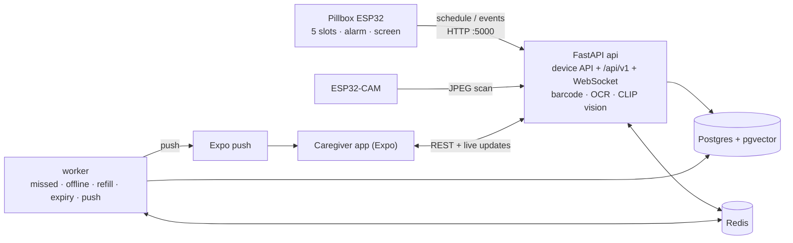

# Medicine reminder prototype

This repo is the backend and caregiver app for an ESP32 pillbox:
- **The pillbox** reminds the patient at dose time.
- **Its camera** recognises medicine packages.
- **Family caregivers** follow everything live on their phone.

Everything runs in Docker. The pillbox firmware is fixed, and the backend speaks its exact API.



More detail: [docs/architecture.md](docs/architecture.md) · API: [docs/api.md](docs/api.md) · Decisions: [docs/decisions.md](docs/decisions.md) · Conventions: `.claude/skills/`.

## Repository
| Path | What |
|---|---|
| `services/api` | FastAPI app + worker (Python 3.12, SQLAlchemy 2, Alembic, uv), vision pipeline, tests |
| `apps/mobile` | Expo SDK 58 + TypeScript + Expo Router caregiver app |
| `tools/device-sim` | Simulator that acts like both ESP32s (stdlib Python) |
| `docs/` | architecture, API, setup, decisions |
| `docker-compose*.yml`, `Makefile`, `Caddyfile` | dev / prod stacks |

## Quick start
Full Windows guide (LAN IP, firewall, phone, push, real pillbox): **[docs/setup.md](docs/setup.md)**.
```bash
cp .env.example .env          # set LAN_IP (your WiFi IPv4) and JWT_SECRET (make secret)
make up                       # db, redis, api :5000, worker, Expo :8081, adminer :8089
make logs-mobile              # scan the QR code with Expo Go; sign in demo@example.com / demo1234
```
The seed creates caregiver `demo@example.com`, patient **Lola Rosa**, and pillbox `pillbox`/`pillbox-cam` with three medicines:
- Losartan 50mg (slot 1, 08:00)
- Metformin 500mg (slot 2, 08:00 + 20:00, **low stock**)
- Amlodipine 5mg (slot 3, 13:00, **expired**)

It also adds three days of history and package reference photos.

## Demo (about 5 minutes)
1. Open the app on the phone: the Home card shows today's progress, the next dose, low stock, the expired medicine, and the pillbox status.
2. Open **Lola Rosa** to see the Today timeline, and keep it open.
3. On the PC run **`make sim`**. The simulated pillbox:
   - polls the schedule;
   - marks Losartan **due** and then **taken** 3 minutes late, so the timeline updates live and the pill count drops by 1;
   - marks Metformin **due** and then **missed**, so within a second the phone shows a "Lola Rosa missed a dose" banner and the Alerts tab gets a new entry (with push, if you use the dev build);
   - resends the missed event, which is stored once (idempotent);
   - presses CAMERA with `tools/device-sim/samples/losartan.jpg`, so the backend identifies **Losartan 50mg** in under 3 s.
4. Open **Scans**: the photo is there. Scan `samples/unknown.jpg` (`python tools/device-sim/sim.py scan tools/device-sim/samples/unknown.jpg`), then correct it in the app; the photo becomes a new reference image.
5. Leave the stack running without the simulator. After 10 minutes the worker raises **Pillbox offline**.

If you run it in the evening when today's doses are past, the simulator walks through the next free day instead. `make reset-seed` starts fresh.

## Tests
```bash
make test            # backend: pytest against real Postgres + Redis (contract, API, jobs, vision); app: Jest + RNTL
make test-contract   # the frozen ESP32 contract only
make eval-vision     # scan accuracy + timing (exit 1 if accuracy < 80%, any wrong medicine, or > budget)
```

## The real pillbox
Set only `BACKEND_URL` to `http://<PC LAN IP>:5000` in the main ESP32 sketch (see [docs/setup.md §8](docs/setup.md)). Port 5000 must be free on the PC and allowed through the Windows firewall.
