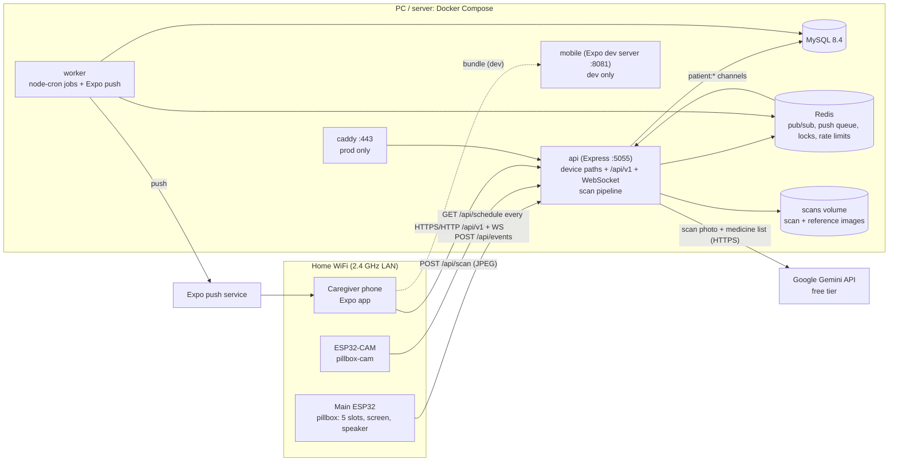
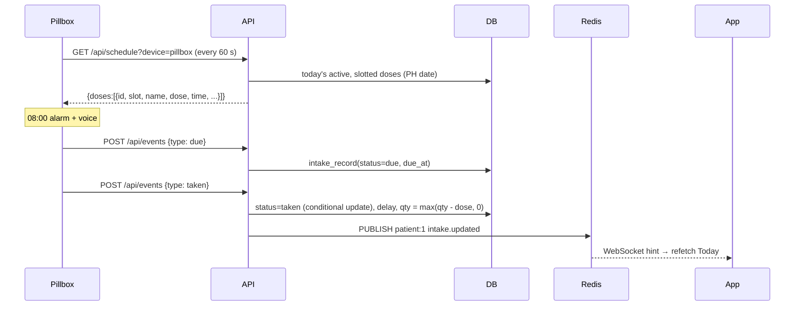
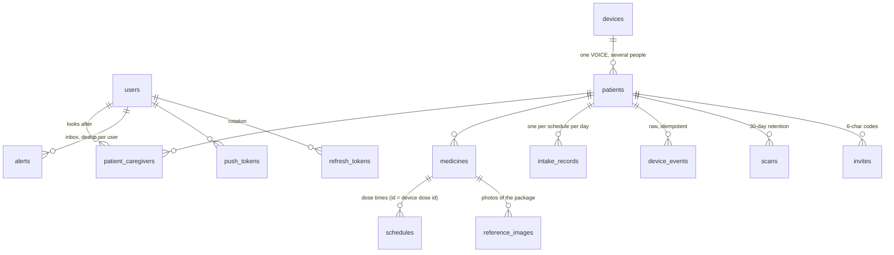

# Architecture

## Overview

- **One Express app** serves the frozen ESP32 contract (`/api/schedule`, `/api/scan`, `/api/events`) and the caregiver API (`/api/v1/...`) on port 5055 (D2, D23).
- **The worker** is the same image with `node dist/src/worker.js`. It runs timed rules and sends Expo push from the Redis queue `push:queue` (D7).
- **Realtime:** services publish small hints (`{type, patientId}`) to Redis after each commit. The `/api/v1/ws` hub forwards them to each caregiver's sockets, and the app refetches the matching queries.

## Code layout and layering

See `.claude/skills/architecture/SKILL.md`. Backend: `routes → services → repositories → Prisma`; `core` is used by all; `jobs` and `routes` are the only entry points into services. App: `src/app` routes → `src/features` → `src/api` hooks → `src/lib`. `src/components` is the design system.

## Main flows

### Dose reminder (device side)

`missed` works the same way. It also inserts one alert per caregiver (deduplicated) and `LPUSH`es the alert ids, which the worker sends through Expo push. If the device never reports, the worker's `reconcile_missed` job marks the dose missed 35 minutes after its time (D8).

### Scan

`POST /api/scan` checks the device, type and size (2 MB); saves the JPEG; then asks **Gemini** (one call, 8 s abort) which of this box's registered medicines is on the package, with a JSON-only answer `{medicineId|null, readName, readStrength, readExpiry, confidence}`. **Code** decides: the id must belong to this box and the confidence must be at least 0.7 (otherwise a fuzzy match on the name it read). The answer to the camera is read from MySQL, never from the model. Any failure answers `{"found":false}` inside the 10 s limit. An unknown scan raises a `scan_unknown` alert. A caregiver correction adds the photo as a new reference photo. Details: `.claude/skills/medicine-vision/SKILL.md`.

## Data model

Key constraints: `device_events (device_id, type, dose_id, local_time)` unique (idempotency), `intake_records (schedule_id, dose_date)` unique, `alerts (user_id, dedup_key)` unique. "One active medicine per slot per VOICE" is checked in the services (MySQL has no partial indexes, D24).

## Time

All instants are UTC `DateTime`s. Schedule times are wall-clock `TIME` in `DEVICE_TZ` (Asia/Manila), because the firmware clock is fixed at UTC+8. Device event times arrive naive and are stored both as `local_time` and as UTC `occurred_at` (D5).

## Security model (summary)

Caregivers use JWT access tokens (15 min) and rotating refresh tokens (30 days, with reuse detection); passwords are hashed with argon2id. Devices have no auth (the firmware is fixed). They are accepted only when paired, are rate-limited, and only see their own patient's data. Port 5055 must stay on the LAN (or behind `DEVICE_PATH_SECRET`); prod exposes only `/api/v1` and `/healthz` through Caddy. Details: `.claude/skills/security-privacy/SKILL.md`.
